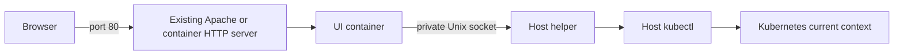

# K9s Web UI

A read-only Kubernetes dashboard with live resource views, logs, YAML manifests,
CPU/memory metrics, and NVIDIA GPU utilization. It uses the Kubernetes context
already selected on the host, just like `kubectl`.

This is an independent project. It is not an official web version of
[derailed/k9s](https://github.com/derailed/k9s), and does not embed its terminal UI.

## Features

- Pods, deployments, services, nodes, events, and persistent volume claims.
- Read-only pod logs and resource YAML; no exec, delete, restart, or secret endpoint.
- NVIDIA DCGM utilization and VRAM, including exporter errors and stale samples.
- Host `KUBECONFIG` / `~/.kube/config` and current-context, with no required config flag.
- HTTP Basic authentication with a locally generated password.
- Static Go executable with embedded HTML, JavaScript and CSS; no CDN or external fonts.
- Existing Apache port 80 integration, or a built-in HTTP server.
- Container deployment uses the exact host kubectl, including vendor builds and credential plugins.
- Native deployment can resolve a missing or incompatible kubectl automatically.

## Container installation

Run on a **Linux Docker host**, as root in the environment where `kubectl` works:

```sh
git clone https://github.com/cwei44/k9s-web-ui.git
cd k9s-web-ui
./scripts/install-container.sh
```

Open **http://HOST-IP/k9s/** on port **80**. Username: `admin`.

```sh
cat /opt/k9s-web-ui-container/dashboard/dashboard-password
```

The script builds a minimal image and installs its static host helper. Docker
Engine/CLI and the host's kubectl must already exist. Go, Node, Python, a shell
inside the image, and terminal k9s are not runtime dependencies. The build needs
internet access to fetch the Go build image; the finished UI image has no base
operating system or downloaded runtime packages. Linux amd64 is tested, including
Docker 18.06; Docker Desktop, remote daemons and rootless Docker are not supported.

The installer chooses the web server automatically:

| Host | Result |
| --- | --- |
| Apache/httpd available | Reuse Apache on port 80; proxy `/k9s/` to the container on `127.0.0.1:19090`. |
| No Apache/httpd; port 80 free | The container's own HTTP server listens on port 80. |
| Another service owns port 80 | Stop with an error; no automatic switch to another port. |

Apache configuration is backed up, syntax checked and verified after activation.
Failed installation restores the Apache configuration. The earlier managed
`setup-k9s-httpd.sh` route is migrated while retaining its IP/authentication rules.
Unrecognized conflicting routes or custom virtual hosts require manual Apache
integration; the installer stops before changing them. Apache 2.4.47+ is required.
An installed but stopped Apache is started when its configuration is suitable.



The helper executes a fixed allowlist of read-only dashboard queries using the
host's actual kubectl, libraries, login files and credential plugins. The UI
container mounts only the helper's private socket directory and its dashboard
password directory. It does not mount a kubeconfig, the host filesystem, or the
Docker socket. The host helper runs as root and is managed by systemd where
available; otherwise it runs detached and needs a host-specific boot supervisor.

No kubeconfig flag is needed. The installer selects host `KUBECONFIG`, or
`~/.kube/config`, and follows later current-context/login changes in those files.
It never downloads or substitutes another kubectl in container mode. An expired
cluster login appears as a connection error in the dashboard; renew the login
on the host and the next refresh picks it up. Environment variables are captured
when installing, so later shell-only environment changes need updating in
`/opt/k9s-web-ui-container/etc/host.env` and restarting the helper.

```sh
docker logs k9s-web-ui
docker stop k9s-web-ui
docker start k9s-web-ui
systemctl status k9s-web-ui-host.service
journalctl -u k9s-web-ui-host.service
```

Docker uses `--restart unless-stopped`; systemd enables the host helper at boot.
Existing deployments are not overwritten. Installation metadata and Apache
backups are in `/opt/k9s-web-ui-container/etc/`. An optional `--prefix` changes
the installation directory. Use `--kubectl /path/to/kubectl` for a particular
host binary, or `--backend-port 19091` if Apache's default backend port is busy.

For an already built/loaded image:

```sh
K9S_WEB_UI_SKIP_BUILD=1 K9S_WEB_UI_IMAGE=k9s-web-ui:local ./scripts/install-container.sh
```

To distribute a package that installs without downloading the image or a compiler:

```sh
make package-container
# Copy dist/k9s-web-ui-container-linux-amd64.tar.gz to another Linux amd64 host:
tar -xzf k9s-web-ui-container-linux-amd64.tar.gz
cd k9s-web-ui-container
./install.sh
```

This archive includes the image, installer, checksums, source and licenses.
The destination still needs Docker and a working host kubectl/login. `install.sh`
verifies the package, loads the image, and performs the same automatic port-80
setup. No kubeconfig or dashboard password is included in the archive.

HTTP Basic authentication requires HTTPS or an SSH tunnel on an untrusted network.
Reuse your existing Apache TLS configuration when needed.

## Native build and run

Supported package target: **Linux x86-64**. Building needs Go 1.23+ and Make.

```sh
git clone https://github.com/cwei44/k9s-web-ui.git
cd k9s-web-ui
make build
./k9s-web-ui serve
```

Open **http://127.0.0.1:8080/k9s/**. Sign in as `admin`; read the generated password:

```sh
cat ~/.config/k9s-web-ui/password
```

`XDG_CONFIG_HOME`, if set, controls the password directory. For remote browser
access, run `./k9s-web-ui serve --listen 0.0.0.0:8080` and use the server's address.
HTTP Basic authentication needs HTTPS or an SSH tunnel on an untrusted network.
The application itself serves HTTP; TLS can terminate at your reverse proxy.

The executable uses an adjacent `bin/kubectl`, then the host's `kubectl`, then a
verified download cached under `~/.cache/k9s-web-ui/kubectl/`. It checks the server
version and resolves an upstream client within one minor when necessary.
`--offline` forbids downloads; `--kubectl /path/to/kubectl` selects a client.
The first fallback download is kubectl v1.35.9. Internet access and trusted CA
roots are needed when a download is required. To prepare for an offline host,
place a compatible official kubectl in `bin/` beside the executable.

No Node, Python, Go runtime, Docker, Apache, or terminal k9s is required to run the
web server. Python 3 is only used to create release archives; Node is only used
for frontend tests. Kubernetes and provider-specific credential helpers remain
external: if your kubeconfig uses `aws`, `gcloud`, `kubelogin`, or a similar tool,
that tool and a valid login must already be available to the running account.

## Use the host's current login

```sh
kubectl config current-context
./k9s-web-ui doctor
./k9s-web-ui serve
```

No `--kubeconfig` argument is necessary. The service reads the original config;
it does not copy credentials. Changes to `current-context` in that config are
picked up on subsequent queries. Resource snapshots cache for five seconds and
GPU snapshots for fifteen seconds; the browser polls every fifteen seconds.
Each resource snapshot uses one context consistently. GPU data from a previous
context is not retained as stale data after a context switch.

An installed service retains the config paths selected during installation.
Changing `KUBECONFIG` only in a later shell does not change those service paths.
Use the same account/environment that has the working Kubernetes login: `sudo`
can change `HOME` or remove `KUBECONFIG`. The system service runs as root; make
sure its credentials are intentionally scoped for that deployment.

Optional overrides:

```sh
./k9s-web-ui serve --context my-context
./k9s-web-ui serve --namespace my-team
./k9s-web-ui serve --kubeconfig /path/to/config
```

`--namespace` limits namespaced resource queries and detail requests; node views
remain cluster-wide. GPU discovery has a separate namespace option. These flags
are not a replacement for Kubernetes RBAC.

## Native service installation

Create a checksummed installation package first:

```sh
make package
cd dist/k9s-web-ui-linux-amd64
# Run as root in the environment where kubectl already works:
./k9s-web-ui install
```

The installer verifies its manifest, checks cluster access, copies the package
to `/opt/k9s-web-ui`, and starts it. It enables a systemd service where available;
otherwise it starts a detached process that needs a host-specific boot supervisor.

Auto mode integrates with a running Apache 2.4.47+ on port 80 when there are no
conflicting `/k9s/` proxies or custom virtual hosts. It locates the required
modules, backs up the main configuration, checks syntax, gracefully reloads, and
verifies the dashboard route. Failed activation rolls back the Apache changes.
Existing website routes are retained.

Without suitable Apache, the built-in server uses port 80 if free, otherwise
8080. For custom virtual hosts, install on loopback and adapt
[apache-example.conf](apache-example.conf) in the intended virtual host:

```sh
./k9s-web-ui install --mode standalone --listen 127.0.0.1:19090
```

The installer prints the URL and password-file location. Defaults:

```sh
cat /opt/k9s-web-ui/etc/dashboard-password
/opt/k9s-web-ui/k9s-web-ui status
/opt/k9s-web-ui/k9s-web-ui stop
/opt/k9s-web-ui/k9s-web-ui start
```

Installed logs are in `journalctl -u k9s-web-ui`, or `etc/service.log` without
systemd. Existing installation paths and service units are not overwritten.
Use `--prefix` for another directory; only one managed systemd instance is
supported. There is no automated upgrade or uninstall command in this version.

## GPU monitoring

GPU utilization comes from **NVIDIA DCGM Exporter**, not Kubernetes GPU resource
allocation. Install the exporter and NVIDIA drivers in your cluster separately.
The dashboard discovers exporter pods and reads port 9400 through the Kubernetes
API pod proxy. It supports device/MIG identities, GPU activity, VRAM used/free,
and any workload labels exposed by DCGM.

```sh
./k9s-web-ui serve --gpu-namespace gpu-operator
./k9s-web-ui serve --gpu-selector app.kubernetes.io/name=dcgm-exporter
```

Default discovery searches all namespaces for `app=nvidia-dcgm-exporter`, falling
back to `app.kubernetes.io/name=dcgm-exporter`. The kubeconfig needs permission to
list the selected pods and get `pods/proxy` in their namespace. Pod-proxy access
can expose services on those pods; scope the credential to the intended exporter
namespace. This package does not install RBAC bindings or modify the cluster.

GPU allocation is not GPU activity. A GPU can retain VRAM with 0% utilization.
Workload labels identify device assignments, not per-process GPU usage. AMD/Intel
telemetry is not supported. Missing metrics remain unavailable, not invented zeroes.
CPU and RAM measurements separately require the Kubernetes metrics API.

## Tests

```sh
make test
```

This runs Go tests and vet plus browser-DOM integration tests using synthetic
cluster data. Tests cover authentication, command/namespace restrictions,
partial failures, context changes, GPU deduplication/MIG/sentinels, stale data,
GPU navigation/filtering, and HTML escaping. No live cluster or credentials are
needed. GitHub Actions runs these checks and builds the installation package.
It also builds the Docker image and checks authentication, the private host
bridge, context switching, and the container's port-80 server using a fake host
kubectl. Run that integration check locally with `make test-container`.

## Distribution and licensing

Project source is licensed under [Apache-2.0](LICENSE). See [NOTICE](NOTICE).
The package script includes an explicit allowlist of files and source, and
writes SHA-256 manifests. It does not include kubeconfigs, login tokens, dashboard
passwords, live cluster fixtures, or third-party CLI binaries. Redistribute the
original package, not an installed directory containing passwords/config backups.

Downloaded kubectl remains covered by Kubernetes and its dependencies' licenses.
If you choose to bundle kubectl or upstream k9s in your own release, include their
required licenses/notices and review their embedded dependencies separately.
This repository does not claim to grant rights to those projects or their marks.
